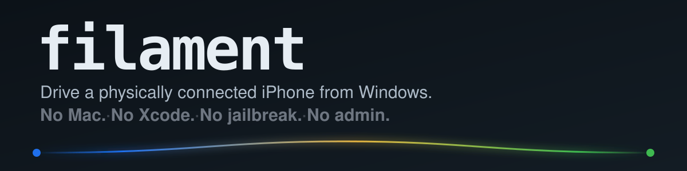
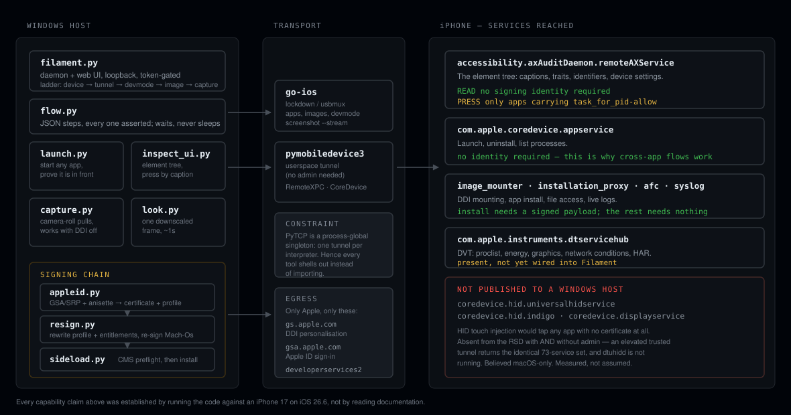

**Created and maintained by [Sergio Rodriguez (SSH-PuR66)](https://github.com/SSH-PuR66).**

**The cable is the control plane.** A Windows-to-iPhone toolchain for inspecting UI state, capturing frames, running asserted flows, and examining the signing/install path. Start with [`filament.py`](filament.py), [automation flows](flows/), and the [device](test_filament.py) / [signing](test_signing.py) tests.

The field notes below distinguish device observations from paths that remain unverified.

---

<p align="center">
  
</p>

<p align="center">
  
  
  
  
  
</p>

---

Appium and Maestro are the two standard ways to automate an iPhone, and neither
runs here. Appium drives iOS through WebDriverAgent, which must be built and
signed with Xcode on a Mac. Maestro's iOS driver runs on Facebook's `idb`, and
its own documentation says iOS builds only work on macOS. Both requirements are
hard.

Filament is what is left when you have a Windows machine, a USB cable, and an
iPhone. It reads the on-screen accessibility tree, launches any app, mirrors the
screen, runs multi-step flows where every step is asserted, and — when you want
to install something — obtains a genuine development certificate from Apple
using your own Apple ID.

Everything below was established by running it against an **iPhone 17 on iOS
26.6 from Windows 11 without administrator rights**. Where something does not
work, this document says so and shows the evidence.

---

## Quick start

**1 — Prerequisites**

| | |
|---|---|
| Python 3.13+ | `py --version` |
| [go-ios](https://github.com/danielpaulus/go-ios) | unpacked to `<tools>/go-ios/ios.exe` |
| iTunes or Apple Devices | supplies the USB driver Windows needs |
| An iPhone | connected by a **data** cable, unlocked, "Trust This Computer" accepted |

Filament expects to live beside its siblings, and derives their paths from its
own location:

```
tools/
├── filament/     ← this repository
├── go-ios/       ← ios.exe and devimages/
└── zsign/        ← only needed for re-signing
```

Any of them can be overridden: `FILAMENT_IOS_EXE`, `FILAMENT_DEVIMAGES`,
`FILAMENT_ZSIGN_EXE`.

**2 — Install the Python dependencies**

```
py -m pip install pymobiledevice3
```

**3 — Start it**

```
cd tools\filament
py filament.py
```

That single command is the whole bring-up. It adopts or starts the tunnel
agent, waits for the phone, re-reveals the Developer Mode row while it is off,
mounts the developer image, and proves capture works by taking a real frame. If
the phone reboots — which unmounts the image — it re-mounts by itself.

It prints a URL carrying a fresh token, also written to `session.url`:

```
http://127.0.0.1:8733/?t=…
```

**4 — Try it without the UI**

```
py launch.py Calculator --verify     # launch, then confirm from the screen
py inspect_ui.py                     # what is on screen right now
py flow.py flows/cross-app.json      # a checked, multi-step run
```

---

## What works without a signing identity

The single most useful thing to know, and it was established by testing rather
than assumption:

| capability | signing identity? |
|---|:---:|
| Read the on-screen element tree | **no** |
| Screenshots and live mirror | **no** |
| Launch any app | **no** |
| Files, installed apps, syslog, battery, accessibility settings | **no** |
| **Tap inside an app** | **yes** |

`perform_press` reaches only processes carrying the `task_for_pid-allow`
entitlement — development-signed builds. SpringBoard and App Store apps accept
a press and silently ignore it: no error, no effect.

That single exception is why `launch` matters so much. Starting an app is a
system service and is not gated on the target app's signature, so
`launch → read → expect` composes into real cross-app automation with no
identity at all:

```
$ py flow.py flows/cross-app.json

  [ ok ] 2/8 launch         com.apple.calculator pid 3713
  [ ok ] 3/8 expect         found 'Delete, Keyboard Key, …'
  [ ok ] 5/8 launch         com.apple.mobilesafari pid 3714
  [ ok ] 6/8 expect_absent  'Keyboard Key' absent  (after 0.6s)

  completed in 17.4s
```

---

## Architecture

<p align="center">
  
</p>

---

## The tools

### `filament.py` — daemon and web UI

```
py filament.py                            # then open the printed URL
FILAMENT_PORT=8734 py filament.py         # a different port
FILAMENT_MOUNT_EGRESS=0 py filament.py    # never contact Apple at all
```

Tabs: **Mirror** (live MJPEG), **Syslog**, **Files**, **Apps**, **Services**,
**Elements** (tree, tap-to-drive), **Install**.

The rail shows a five-rung ladder — device, tunnel, devmode, image, capture. A
rung reads `open` only on evidence, and `wait` ("blocked by an earlier rung") is
deliberately not the same as `shut` ("refused").

### `flow.py` — multi-step automation where every step is checked

```
py flow.py flows/cross-app.json
py flow.py flows/cross-app.json --dry-run
```

Steps: `launch`, `read`, `expect`, `expect_absent`, `tap`, `tap_index`, `focus`,
`wait`, `shot`, `note`.

```json
[
  {"launch": "Calculator"},
  {"expect": "Keyboard Key"},
  {"shot": "at-calculator.png"},
  {"launch": "Safari"},
  {"expect_absent": "Keyboard Key"}
]
```

A flow stops at the first failed expectation and prints what was actually on
screen. `expect` and `expect_absent` **wait** rather than sampling once: they
re-read until the condition holds or a timeout expires — 6s by default,
`--timeout N`, or per-step `{"expect": "X", "timeout": 20}`. The first check is
immediate, so a screen that is already correct costs nothing, and a passing step
reports how long it actually waited. That number is the useful part: a step that
habitually waits 5.8s is one bad connection away from failing.

The assertion straight after a `launch` gets **45s** instead. That is not a
magic number sprinkled on a flaky test — the same Calculator → Safari switch was
measured settling in 1.1s, then 21.3s on a busy phone, then 0.6s. An app
reaching the front is a slower and far more variable event than a label
changing.

This replaced fixed `sleep` padding, the usual way flaky UI automation gets
written. A blind sleep is either too short or too long, and it is always both on
a different day. `cross-app.json` got **faster** when the waits became
conditional — 31.5s to 22.2s — because it now waits exactly as long as the
phone takes.

### `launch.py` — start an app, prove it is in front

```
py launch.py --list --system
py launch.py Calculator --verify
py launch.py com.apple.mobilesafari
```

`--verify` matters: a returned PID proves a process started, not that anything
is on screen. iOS starts apps happily behind a dark display.

### `inspect_ui.py` — the element tree

```
py inspect_ui.py
py inspect_ui.py --json --limit 40
py inspect_ui.py --press-caption Settings
```

### `capture.py` / `look.py` — frames

```
py capture.py            # newest screenshot from the camera roll, over plain AFC
py capture.py --watch    # press Volume Up + Side; it lands here
py look.py               # one downscaled frame in about a second
```

`capture.py` works with Developer Mode off entirely.

### `appleid.py` — a signing identity from a free Apple ID

This one lives in its own virtualenv, because the anisette provider pulls in a
CPU emulator that has no business in the interpreter driving the phone:

```
py -m venv .signing-venv
.\.signing-venv\Scripts\pip.exe install anisette srp cryptography requests certifi
```

```
.\.signing-venv\Scripts\python.exe appleid.py doctor
.\.signing-venv\Scripts\python.exe appleid.py login --apple-id you@example.com
.\.signing-venv\Scripts\python.exe appleid.py identity --bundle-id com.you.app
```

Asks Apple for a real development certificate — the same request Xcode makes,
against the same endpoints, using your own Apple ID. It does **not** defeat code
signing; it uses it. A free Apple ID yields a 7-day certificate covering 3 apps.

`identity` runs the whole path: register the attached device (UDID read from the
phone, not typed), generate a 2048-bit key **locally**, have Apple sign the CSR,
register the App ID, and download the provisioning profile.

**Run `doctor` first.** It checks every link in the chain in the order they fail
— dependencies, clock skew against Apple's own clock, anisette, device, session
— and prints what to fix. Clock skew is on that list because the anisette
one-time password is time-based: a few minutes of drift fails at the *password*
stage, which is a thoroughly misleading place for it to surface.

A failed login reports **which of the five protocol stages** it died in
(anisette → srp-init → password → 2fa → token) with advice specific to that
stage, and appends a line to `.signing/login.log`.

**Which Apple ID?** "Free" is the account *tier*, not a separate account —
every Apple ID has a free Personal Team good for 7-day certificates. You can
use a throwaway Apple ID rather than the one holding your photos and payment
methods; the app does not care which account signed it, you simply trust the
developer profile on the device afterwards. A fresh account has no Apple
devices to push a code to, so it verifies over SMS:

```
.\.signing-venv\Scripts\python.exe appleid.py login --apple-id you@example.com --sms
```

Left alone, the method is chosen by asking Apple what the account actually
has. `--trusted-device` forces the push; `--phone-id` picks between numbers.

Two things about that throwaway account are worth knowing before you try:

- **Apple refuses VoIP numbers** — Google Voice, Twilio, TextNow — as trusted
  numbers, so there is no "get a disposable number" shortcut. A public
  SMS-receiving site is worse than no plan at all: a shared inbox means anyone
  can take over the account holding your signing certificate.
- **You do not need a second number.** Apple accepts the *same* phone number
  as a trusted number on more than one Apple ID, so an existing handset number
  can verify a new development-only account.

Credentials, stated plainly: the **password is never stored** — read via
`getpass`, used for the SRP exchange, dropped. The **private key never leaves
this machine**; Apple only ever sees the CSR. The session token *is* saved,
because the alternative is repeating 2FA on every command — treat
`.signing/session.json` as a credential.

Login is CLI-only by design. The daemon shows signing *state* but has no
password field: a browser will offer to remember one, and the page URL already
carries a session token.

### `resign.py` — make a downloaded `.ipa` installable

```
py resign.py check app.ipa --p12 id.p12 --profile x.mobileprovision
py resign.py sign  app.ipa --p12 id.p12 --profile x.mobileprovision
```

An `.ipa` from the internet carries either someone else's provisioning profile
or none at all. iOS refuses those before considering anything else — which is
what "the app just won't install" actually means. Re-signing replaces
`embedded.mobileprovision`, rewrites entitlements to match it, and re-signs
every Mach-O in the bundle with fresh CodeDirectory hashes and a CMS blob.

This wraps [zsign](https://github.com/zhlynn/zsign), **pinned by SHA-256**
against the digest published with the release:

```
zsign v1.1.2 · zsign-windows-x64.zip
96b5bf7029a52c67cdb78b68b3666d8ff1e31e5c435535964be2a482afc09e5c
```

Two things it adds over calling zsign directly. A **preflight**, including that
the certificate chains to Apple's WWDR intermediate — zsign otherwise parses the
profile, starts signing frameworks, and only then fails with `Unknown issuer
hash`. And a **post-check**: the output is reopened and confirmed to carry the
profile and signature that were the point. A zero exit code means the tool ran,
not that the artefact is right.

### `sideload.py` — install, with the preflight done first

```
py sideload.py check   app.ipa --p12 id.p12 --profile x.mobileprovision
py sideload.py install app.ipa --p12 id.p12 --profile x.mobileprovision
```

Verifies the profile's CMS signature against a digest-pinned Apple Root CA
**before** uploading anything, so a doomed install fails in a second with the
real reason instead of after a minute with `ApplicationVerificationFailed
0xe8008001`.

### `rcsign.py` — when zsign cannot seal the app

```
py rcsign.py app.ipa --pem key.pem --pem cert.pem --profile x.mobileprovision \
   --bundle-id com.example.app.TEAMID --out app-signed.ipa
py sideload.py install app-signed.ipa
```

Reached for exactly once so far, and it was needed. LiveContainer+SideStore
embeds `SideStoreApp.framework`, whose executable is named `SideStore` and
which carries four more frameworks *inside* it. zsign signs that layout
top-down: it seals the parent's resources, then re-signs the children, so the
seal is stale before the file is even zipped and iOS answers `0xe8008017`
("a signed resource has been added, modified, or deleted"). go-ios's signer
skips the framework entirely (`0xe800801c`, no signature at all). rcodesign —
[apple-codesign](https://github.com/indygreg/apple-platform-rs), pinned by the
SHA-256 published with its release — signs bottom-up and the same `.ipa`
installed first time.

The script does the four things around the signer that each cost an install
attempt to learn: it works on a **short path** (the nested frameworks push
`%TEMP%\<long>` past MAX_PATH and every tool in the chain fails quietly past
it — Sideloadly mangles names to `%%1`, `%%2` for the same reason); it strips
`PlugIns` unless told not to, because a free-tier profile covers one app id
and every extension carries its own; it rewrites the bundle id to the one the
profile names; and it hands rcodesign the entitlements by a **relative** path,
because `--entitlements-xml-file C:\...` is parsed as scope `C` and the main
binary ends up with no entitlements and `0xe8008015`.

The identity can be the PEM pair Sideloadly keeps in `%APPDATA%\Sideloadly`
(`key.pem`, `cert-<apple id>.pem`), which is the same certificate that signed
whatever Sideloadly last installed. A p12 works too, but only one written with
`openssl pkcs12 -export -legacy`; rcodesign 0.29 reports an OpenSSL 3 default
p12 as a wrong password.

### `devmode_doctor.py` — why Developer Mode will not turn on

```
py devmode_doctor.py            # read-only, three independent reads
py devmode_doctor.py --enable   # show AMFI's raw refusal
```

Do not trust `ios devmode get` alone: go-ios discards its error, so a locked
device reads identically to genuinely-off.

### The full install chain

```
appleid.py identity  →  identity.p12 + identity.mobileprovision
resign.py sign       →  app-resigned.ipa
sideload.py install  →  onto the device
```

If `sideload.py install` comes back with `0xe8008017` naming a framework,
swap `resign.py sign` for `rcsign.py` — see above. The provisioning profile
Sideloadly last used is at `%LOCALAPPDATA%\Temp\tmp*\%%1\%%1.app\embedded.mobileprovision`
and is good for seven days from that install.

---

## Tests

```
py test_filament.py                                 # 83 tests
.\.signing-venv\Scripts\python.exe test_signing.py  # 63 tests
```

No device, no network, no Apple ID required for either. Each of the 76 in the
first suite corresponds to a defect that was actually present and found by
running the code — a refcount that leaked a screen broadcast on `0.0.0.0`, a
token comparison that raised on a non-ASCII character and killed the request, a
backoff that failed to arm on the early-return paths.

The 63 signing tests pin down what Apple's crypto lets you get wrong *quietly*:
the wrong PBKDF2 variant reads as "bad password", a dropped GCM AAD still
decrypts on some libraries, and a certificate field renamed between API
generations reads as success followed by an empty file. Each is tested by
round-trip **and** by tamper-rejection — a decryption test that only checks the
happy path proves almost nothing.

---

## Field notes

Things that cost real time to discover, recorded so they cost no one else any.

- **zsign seals a framework before it signs the frameworks nested inside it.**
  Frameworks-in-frameworks are rare on iOS but LiveContainer+SideStore ships
  one; the parent's `CodeResources` then hashes the children's pre-signing
  bytes and iOS rejects the parent with `0xe8008017`. Ordinary `.app` →
  `Frameworks/` layouts are fine, which is why this took a diff of the seal
  against the files to see.
- **go-ios `sign app` skips a framework whose executable name differs from the
  framework name** (`SideStoreApp.framework/SideStore`), leaving it unsigned.
- **rcodesign reads a Windows drive letter as a scope prefix.**
  `--entitlements-xml-file C:\x\ent.plist` is scope `C`, path `\x\ent.plist`;
  nothing complains and the main binary ships without entitlements. Pass the
  file relative to the working directory.
- **MAX_PATH is still 260 for these tools.** Under a long `%TEMP%` subfolder
  the deepest SideStore bundle path is over the limit; `unzip`, `zipfile` and
  zsign each stop at the boundary without an error you would notice.
- **`sys.stdout.reconfigure(line_buffering=True)` is not enough on a cp1252
  console.** An app label containing U+200E killed `launch.py --verify` after
  the launch had already succeeded. Every tool now sets `encoding="utf-8",
  errors="replace"` as well.

- **`ios image list` reports mounts as INFO log lines**, not as a payload.
  Reading it as a payload says "not mounted" forever.
- **go-ios prints nothing for write commands** (`enable`/`disable`/`toggle`) and
  exits 0. Judge those by exit code; judge reads by parsed payload.
- **`ios screenshot --stream` ignores `--port`, hardcodes 3333, and binds
  `0.0.0.0`** with `Access-Control-Allow-Origin: *`. Filament proxies it behind
  its own token and kills the child when the last viewer leaves.
- **PyTCP is a process-global singleton.** pymobiledevice3 gets exactly one
  in-process tunnel per interpreter, which is why these tools shell out to each
  other rather than importing.
- **`python -m pymobiledevice3 afc ls` hangs forever as a subprocess.** Use the
  library in-process.
- **A changing screen does not prove a tap landed.** A phone playing media
  repaints constantly; verify against the element tree, not a pixel diff.
- **`gsa.apple.com` chains to Apple's *private* PKI, so certifi rejects it** with
  `CERTIFICATE_VERIFY_FAILED: self-signed certificate in certificate chain`,
  while a browser accepts it happily. It surfaces during login as an `SSLError`
  and reads like a network problem. `appleid.py` builds an explicit bundle of
  certifi plus the digest-pinned Apple Root CA. Both tempting shortcuts are
  worse: `verify=False` removes the check that makes TLS worth having, and
  trusting the OS store is a moving target.
- **Apple's GSA login must run twice when 2FA is involved.** The first login only
  ever yields a 2FA-gated SPD; validating the code does not upgrade it.
- **`sk` for the app-token step comes from the decrypted SPD, not the SRP session
  key.** Two different keys, both plausibly named, one paragraph apart in the
  protocol. Using the wrong one fails authentication with no hint as to why.
- **`CoreADI64.dll` is a dead end for anisette.** It ships with Apple Application
  Support, which makes it look like the obvious Windows-native route. It exports
  two FairPlay-obfuscated symbols and nothing else.
- **The untrusted tunnel gets a smaller service set, and nothing says so.** Its
  RSD advertises 73 services and silently omits `hid.*`, `displayservice` and
  `screencaptureservice`. Nothing reports "you are on a reduced peer" — services
  are simply absent, so it looks like an unsupported iOS version.

---

## What does not work here, and how that was established

HID touch injection would tap any app with no certificate at all —
`com.apple.coredevice.hid.universalhidservice` publishes a virtual touchscreen
whose reports arrive as genuine `UIEventTypeTouches`. It is not available to a
Windows host. That was worth proving rather than assuming:

1. The no-admin userspace tunnel advertises 73 services; none are `hid.*`,
   `displayservice`, or `screencaptureservice`.
2. Running `pymobiledevice3 remote tunneld` **as administrator** produces a
   trusted tunnel with the *identical* 73-service set. Admin changes nothing.
3. Connecting to the service anyway returns `InvalidServiceError: No such
   service`.
4. `dvt proclist` shows `backboardd` running but **no `dtuhidd`** — the DDI
   daemon that would publish them — though the image is mounted.

**Hypothesis, labelled as one:** those three services back macOS iPhone
Mirroring, and pymobiledevice3's source notes their wire formats were decoded by
sniffing Xcode-mirror sessions. The device likely publishes them only to a host
that completed the macOS-side trust. Unproven — what is proven is that they are
absent from Windows with and without admin.

`touch.py` ships anyway. It reports exactly this instead of raising an
`InvalidServiceError` from three frames down, and its coordinate handling and
report framing are tested, so the day the services appear it is ready.

---

## Egress

The default is zero. Three things are allowed to leave the machine, all of them
to Apple, none of them silent.

| destination | why | how to refuse |
|---|---|---|
| `gs.apple.com` | Per-device signature to mount the developer image on iOS 17+. Once per image; re-mounts are offline. | `FILAMENT_MOUNT_EGRESS=0` |
| `gsa.apple.com` | Apple ID sign-in. Only `appleid.py` ever contacts it. | don't sign in |
| `developerservices2.apple.com` | Requesting the certificate and profile. | don't sign in |

The `anisette` package additionally fetches Apple's ADI library (~3 MB) the
first time it provisions, then caches it; it also accepts a locally supplied
bundle.

Notably **not** on that list: any third party. No remote anisette server, no
signing service, no telemetry. Device identification and authentication material
go to Apple or nowhere.

Mounting the developer image chains to Apple's private PKI, so Apple Root CA was
installed to the current user's trust store during setup — no admin, and
reversible:

```powershell
Remove-Item Cert:\CurrentUser\Root\611E5B662C593A08FF58D14AE22452D198DF6C60
```

---

## Design rules

1. **Loopback only.** Binds `127.0.0.1`; every request carries a token minted at
   startup and compared in constant time.
2. **Zero egress**, with the three gated exceptions above.
3. **Honest gating.** A capability the device refuses is shown locked *with the
   real reason* — never hidden, never faked, never a synthesised explanation.
   "Waiting on an earlier step" must not render as "failed".

Rule 3 is why the ladder distinguishes `wait` from `shut`, why the mirror
unlocks on a real captured frame rather than on Developer Mode being on, and why
`flow.py` prints the actual screen when an expectation fails.

---

## When something is wrong

```
py devmode_doctor.py     # Developer Mode specifically
py appleid.py doctor     # the signing chain
py test_filament.py      # did an edit break an invariant
```

`/api/state` carries the full ladder plus tunnel, screen and supervisor state —
the fastest single look at what the daemon believes.

---

## Scope

Filament does not attempt to defeat iOS code signing, and will not. Signing is
enforced cryptographically by the OS; working around it is exploitation, not
engineering. Everything here either needs no identity at all, or uses the
legitimate path Apple provides to developers with their own Apple ID.

## License

MIT — see [LICENSE](LICENSE).

Built on [pymobiledevice3](https://github.com/doronz88/pymobiledevice3),
[go-ios](https://github.com/danielpaulus/go-ios), and
[zsign](https://github.com/zhlynn/zsign).
